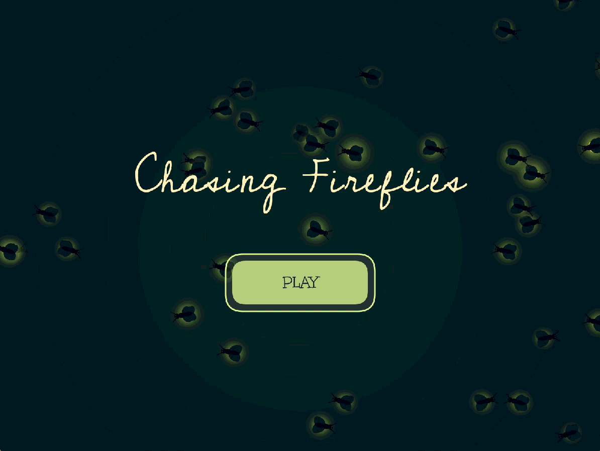
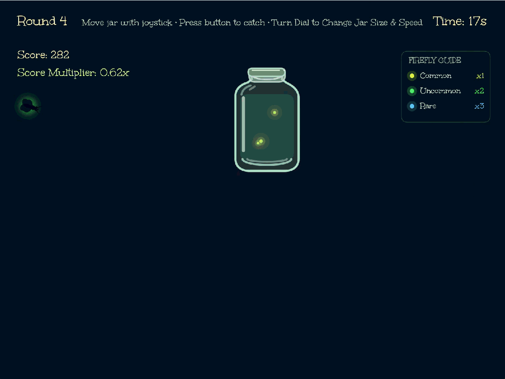
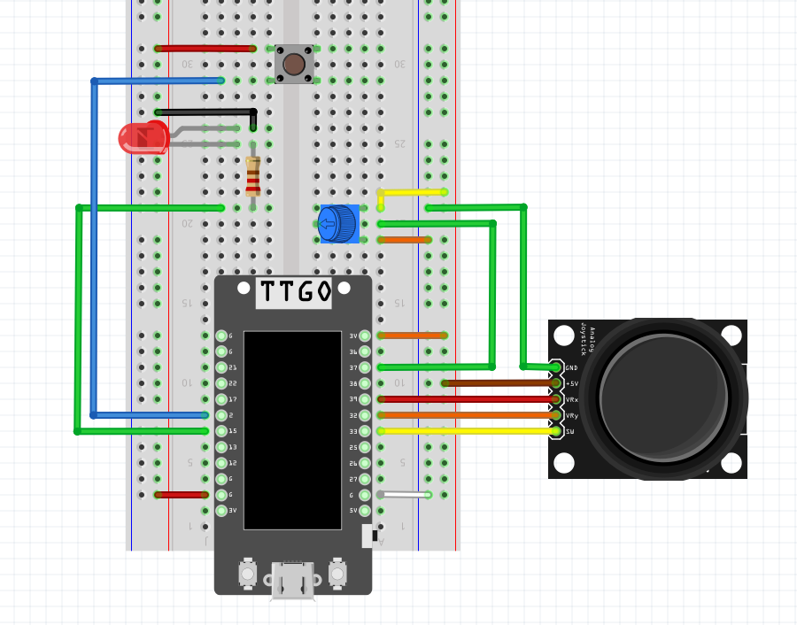

# chasing-fireflies

## About
**Chasing Fireflies** is an interactive Processing game where players catch glowing fireflies using a joystick, button, and potentiometer with custom animations, progressive difficulty, and a persistent leaderboard. An ESP32 TTGO T-Display collects sensor data from the components and sends it to a laptop over a serial connection.

**[Blog Post](https://victoria3452.github.io/chasing-fireflies.html)**

---

## Demo
<table>
  <tr>
    <td>
      <iframe
        src="https://www.youtube.com/embed/4JUIxUYemsc?autoplay=1&mute=1&playsinline=1"
        title="Chasing Fireflies Demo"
        width="400"
        height="711"
        allow="autoplay; encrypted-media"
        allowfullscreen>
      </iframe>
    </td>
    <td></td>
  </tr>
  <tr>
    <td></td>
    <td></td>
  </tr>
</table>

[Video of full game](https://youtube.com/shorts/4JUIxUYemsc?is=OvRwwfRdvMcsbrXk)

## Design Goals
- Create glowing, animated fireflies using procedural graphics
- Control a virtual jar using a physical joystick
- Adjust jar size and speed using a potentiometer
- Catch fireflies with a physical button
- Increase difficulty across rounds
- Animate captured fireflies escaping at the end of the game

---

## Installation & Reproduction

### Hardware
- ESP32 TTGO T-Display
- USB-C cable
- Computer running Arduino IDE
- Joystick
- Potentiometer
- Button / switch
- 220 Ω resistor
- LED
- Breadboard
- Jumper wires
- 5x Female / Male wires

### Software
- Arduino IDE
- Processing IDE

### Running the Project
1) **Wire the hardware.** Connect the joystick’s X, Y, and switch outputs to ESP32 GPIO pins 39, 32, and 33, respectively. Connect the potentiometer to GPIO 37 and the button to GPIO 2.

  

2) **Upload the controller sketch to ESP32 in Arduino IDE.** 
3) **Run the game.** Open the Processing sketch, select the serial port connected to the ESP32, and run the program. The ESP32 sends sensor data to the game over serial at 9600 baud.
4) **Play!** Move the joystick to control the jar, turn the potentiometer to adjust its size and speed, and press the button to catch fireflies.
